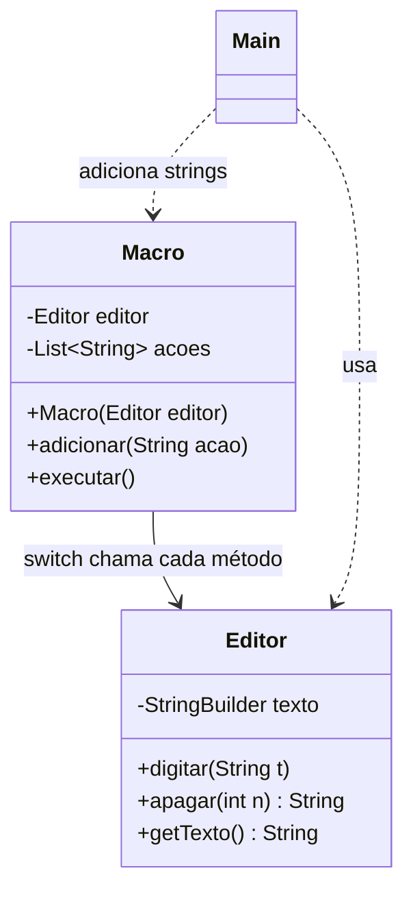
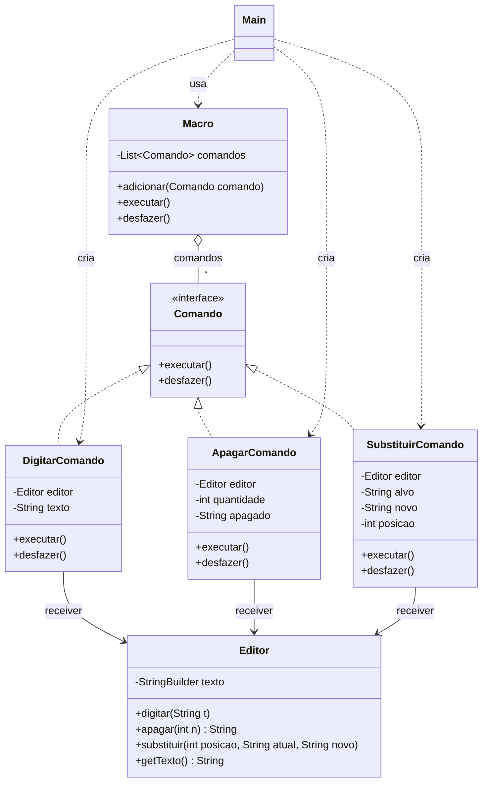

# Respostas: Padrão Command

## Exercício 1: Aplicações

**1. Barra de ferramentas de um editor com desfazer/refazer**

Faz sentido usar Command. Cada botão pode guardar um objeto de comando e só chamar `executar()`, sem saber o que a operação faz por dentro. Como cada comando também sabe se desfazer, dá para guardar os comandos executados em uma pilha e ter o desfazer/refazer.

**2. Agendador de tarefas com fila e cancelamento**

Faz sentido usar Command. Cada job vira um objeto que pode ser colocado na fila e executado depois, por quem quer que esteja processando a fila. Para cancelar antes da execução é só tirar o objeto da fila, coisa que não daria para fazer se o pedido fosse uma chamada direta de método.

**3. Sistema de macros que grava e repete ações**

Faz sentido usar Command. Cada ação gravada vira um comando, e a macro é só uma lista de comandos que são executados em sequência. A própria macro pode ser tratada como um comando único, e ainda dá para desfazer tudo na ordem inversa.

**4. Classe `Relatorio` que sempre gera o mesmo PDF**

Não faz sentido usar Command. A operação é única e fixa, não tem fila, não tem parâmetros variando e ninguém precisa desfazer. Transformar isso em comando só criaria classes a mais sem ganhar nada, seria overengineering.

**5. Classe `Ponto` com apenas `x` e `y`**

Não faz sentido usar Command. A soma das coordenadas é um método simples, que nunca precisa ser revertido, enfileirado ou agendado. Chamar o método direto já resolve, e o padrão só deixaria complicado algo que é simples.

---

## Exercício 2: Rastreando o anti-pattern em um projeto real

O código original ficou no pacote `antes` e a versão refatorada no pacote `depois`, para dar para comparar os dois.

### 1. Por que o `switch` na `Macro` é um acoplamento forte?

A `Macro` deveria só guardar as ações e mandar executar, mas ela sabe de tudo: conhece o nome de cada ação, como separar o parâmetro da string, qual método do `Editor` chamar e qual conversão fazer (`Integer.parseInt` no `APAGAR`). Ou seja, o invocador está amarrado às operações e ao `Editor`. Qualquer mudança em uma operação pode obrigar a mexer na `Macro`.

Para adicionar a ação `SUBSTITUIR` seria preciso criar o método no `Editor` e também abrir a `Macro` para colocar mais um `case` no `switch`, com a lógica de separar os dois parâmetros. Cada ação nova altera uma classe que já funcionava, o que quebra o princípio aberto/fechado. E com o tempo o `switch` só cresce.

### 2. Problemas de usar strings como `"DIGITAR:Ola"`

Como a ação é uma string, o compilador não ajuda em nada. Ele aceita `"DIGITA:Ola"`, `"APAGAR:abc"` ou `"APAGAR"` sem reclamar, e o erro só aparece quando a macro roda. Não tem tipo para o parâmetro (o número do `APAGAR` é texto até ser convertido) e não tem validação nenhuma antes da execução.

Se o parâmetro vier no formato errado, acontecem coisas diferentes:

- `"APAGAR:abc"` dá `NumberFormatException` no `parseInt`;
- `"APAGAR"` sem parâmetro dá `ArrayIndexOutOfBoundsException`, porque não existe `partes[1]`;
- `"DIGITAR:10:30"` não dá erro nenhum, mas digita só `"10"`, porque o `split(":")` corta o resto. É um erro silencioso;
- um nome errado cai no `default` e lança `IllegalArgumentException`.

Pior ainda: se o erro acontecer no meio da macro, os passos anteriores já foram aplicados no editor e não tem como voltar.

### 3. Por que não dá para desfazer a macro?

Porque a `Macro` só guarda as strings e chama o `Editor`, ninguém guarda o que é preciso para voltar cada passo. O `Editor.apagar` até devolve o texto removido, mas a `Macro` ignora esse retorno. Então, depois de rodar o `Main`, o `"mundo"` virou `"mu"` e os três caracteres apagados se perderam.

Para reverter seria preciso que cada passo soubesse fazer o contrário do que fez e guardasse a informação para isso. No `DIGITAR`, apagar a mesma quantidade de caracteres que foi digitada. No `APAGAR`, guardar o texto que foi removido para digitar de novo. Além disso, os passos teriam que ser desfeitos na ordem inversa, do último para o primeiro.

### 4. Refatoração com Command

#### Diagrama de classes: antes

#### Diagrama de classes: depois

#### Código refatorado

Fica em `src/main/java/br/venson/net/designpatterns/command/depois/`:

- [Comando.java](src/main/java/br/venson/net/designpatterns/command/depois/Comando.java): interface de comando, com `executar()` e `desfazer()`.
- [DigitarComando.java](src/main/java/br/venson/net/designpatterns/command/depois/DigitarComando.java) e [ApagarComando.java](src/main/java/br/venson/net/designpatterns/command/depois/ApagarComando.java): comandos concretos, cada um com o editor, os parâmetros e o que precisa para se desfazer.
- [SubstituirComando.java](src/main/java/br/venson/net/designpatterns/command/depois/SubstituirComando.java): comando novo, para mostrar que uma ação nova não mexe na `Macro`.
- [Editor.java](src/main/java/br/venson/net/designpatterns/command/depois/Editor.java): receiver, faz o trabalho de verdade no texto.
- [Macro.java](src/main/java/br/venson/net/designpatterns/command/depois/Macro.java): invoker, guarda os comandos e só chama `executar()` e `desfazer()`.
- [Main.java](src/main/java/br/venson/net/designpatterns/command/depois/Main.java): cliente, monta os comandos, executa a macro e depois desfaz tudo.

#### Justificativa das decisões de design

**Interface `Comando`.** Criei uma interface com só dois métodos, `executar()` e `desfazer()`. É tudo que o invocador precisa saber sobre uma ação. Com isso o pedido deixa de ser uma string e vira um objeto com tipo, que a `Macro` consegue tratar sempre do mesmo jeito, não importa qual ação seja.

**Comandos concretos com o próprio desfazer.** Cada comando recebe no construtor o `Editor` e os parâmetros já com o tipo certo, então `new ApagarComando(editor, "abc")` nem compila. Cada um também guarda o que precisa para voltar atrás: o `DigitarComando` usa o tamanho do texto digitado, o `ApagarComando` guarda o que foi apagado (agora o retorno do `apagar` é usado) e o `SubstituirComando` guarda a posição onde trocou. Quem sabe desfazer uma ação é a própria ação, e não a `Macro`.

**Receiver `Editor`.** O `Editor` continua só com as operações de texto e não sabe que existem comandos ou macros. Mantive os métodos que já existiam e só adicionei o `substituir`, que é a operação nova que o `SubstituirComando` precisa.

**Invoker `Macro`.** Tirei o `switch` e também o `Editor` da `Macro`. Agora ela tem só uma `List<Comando>`, executa na ordem em que foram adicionados e desfaz de trás para frente, porque cada passo depende do texto que o anterior deixou. Ela não conhece `digitar`, `apagar` nem `substituir`.

**Cliente `Main`.** Quem decide quais ações entram e com quais parâmetros é o `Main`. Ele cria os comandos ligando cada um ao editor e entrega para a macro. Usei a mesma sequência do original (`"Ola "`, `"mundo"`, apagar 3) e coloquei um `SubstituirComando` no final. A macro deixa o texto como `"Oi mu"` e o `desfazer()` volta tudo até o texto ficar vazio.

### 5. Como fica adicionar uma ação nova? E enfileirar, agendar e desfazer?

Agora uma ação nova é só uma classe nova que implementa `Comando`. Foi o que fiz com o `SubstituirComando`: criei a classe, coloquei o método `substituir` no `Editor` e pronto. A `Macro` não foi alterada em nada, porque ela só trabalha com a interface. Não tem mais `switch` crescendo nem string para interpretar.

Como o pedido agora é um objeto, ele pode ser guardado e passado para qualquer lugar. Dá para colocar o mesmo comando em uma fila (`Queue<Comando>`) e executar depois, dá para entregar para um agendador que chama `executar()` em outro momento e dá para guardar os comandos já executados em uma pilha e chamar `desfazer()` neles. Quem enfileira ou agenda não precisa saber o que o comando faz, só que ele é um `Comando`. Na `Macro` isso já aparece: ela guarda a lista, executa quando for chamada e consegue desfazer tudo, coisa que antes era impossível.
